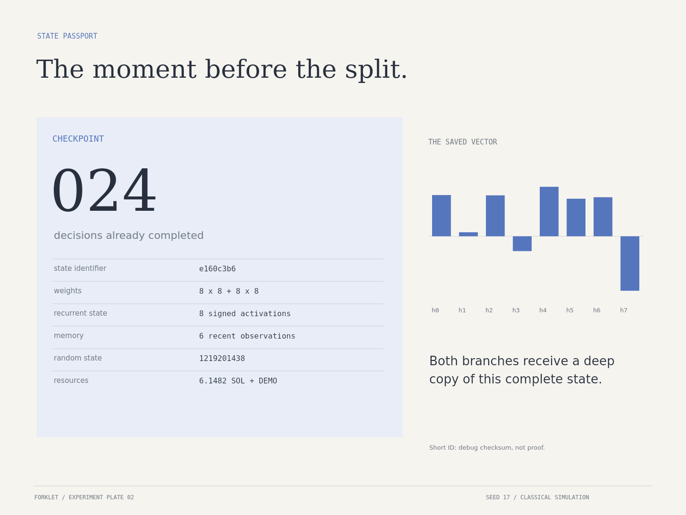
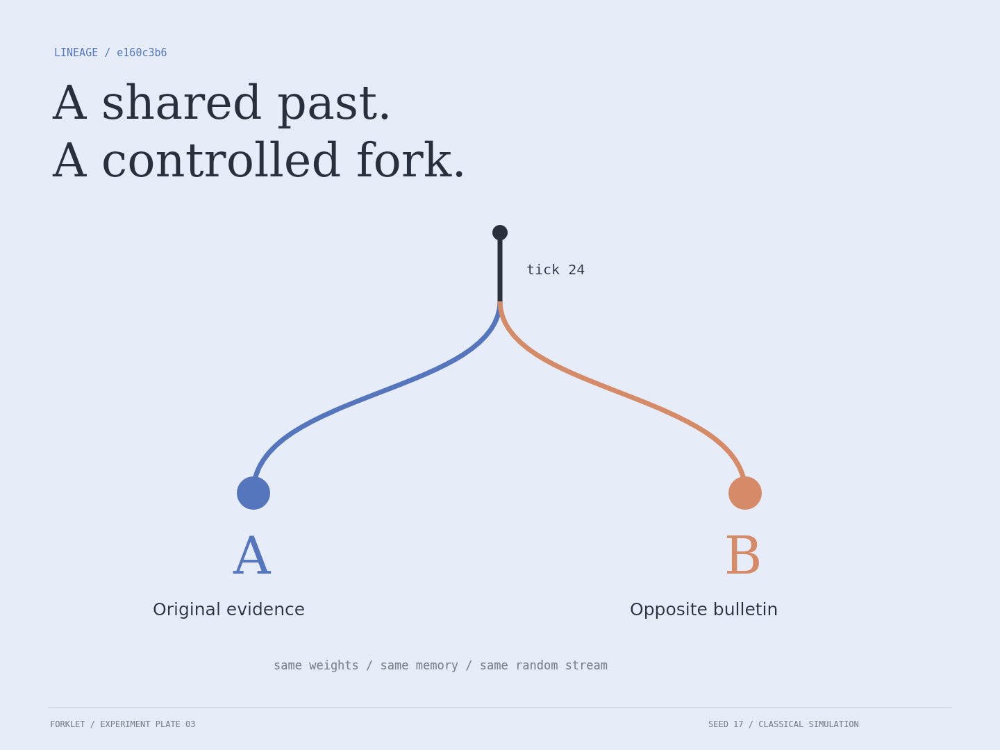
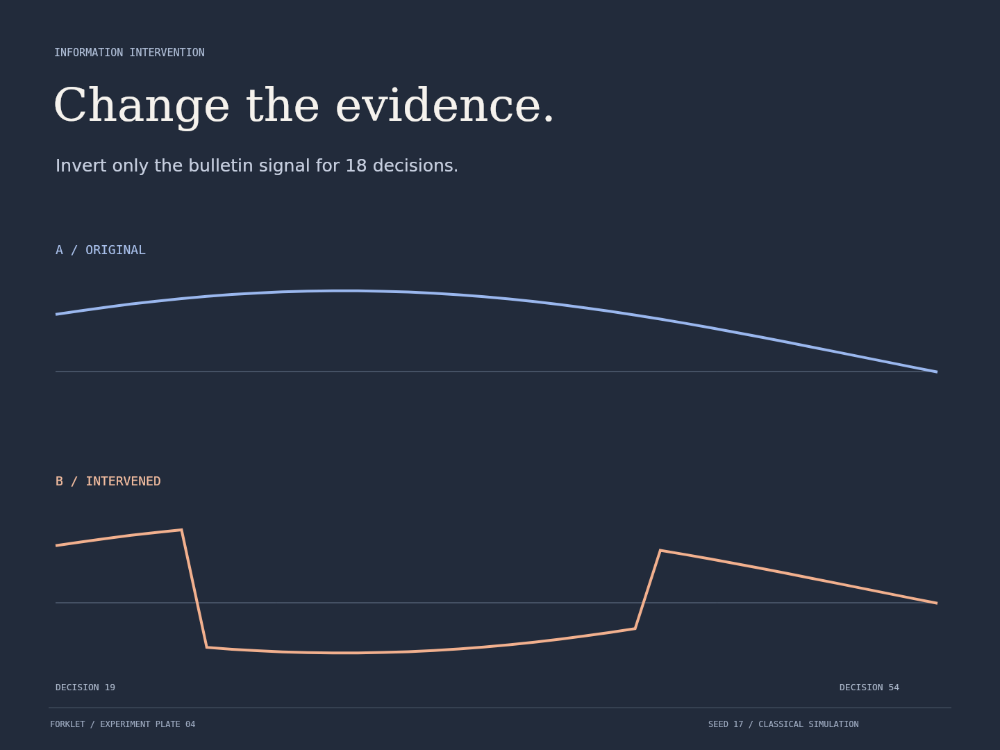
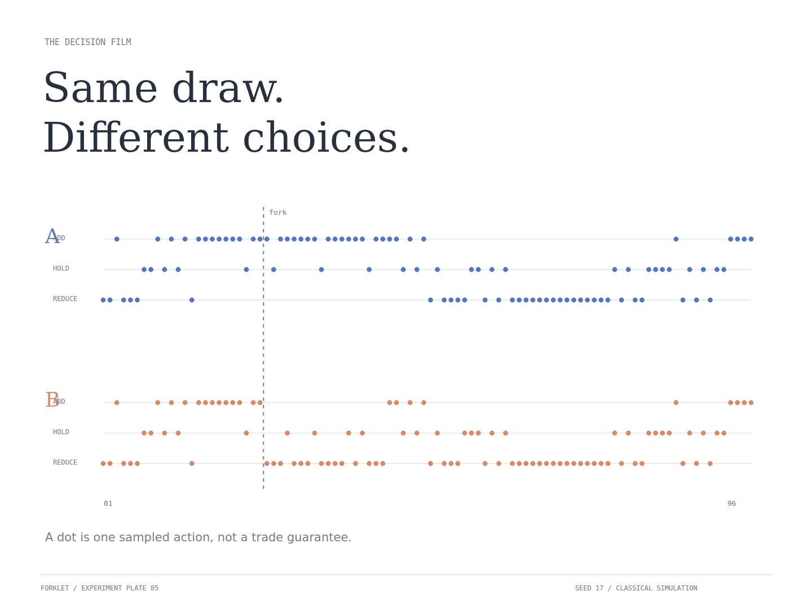
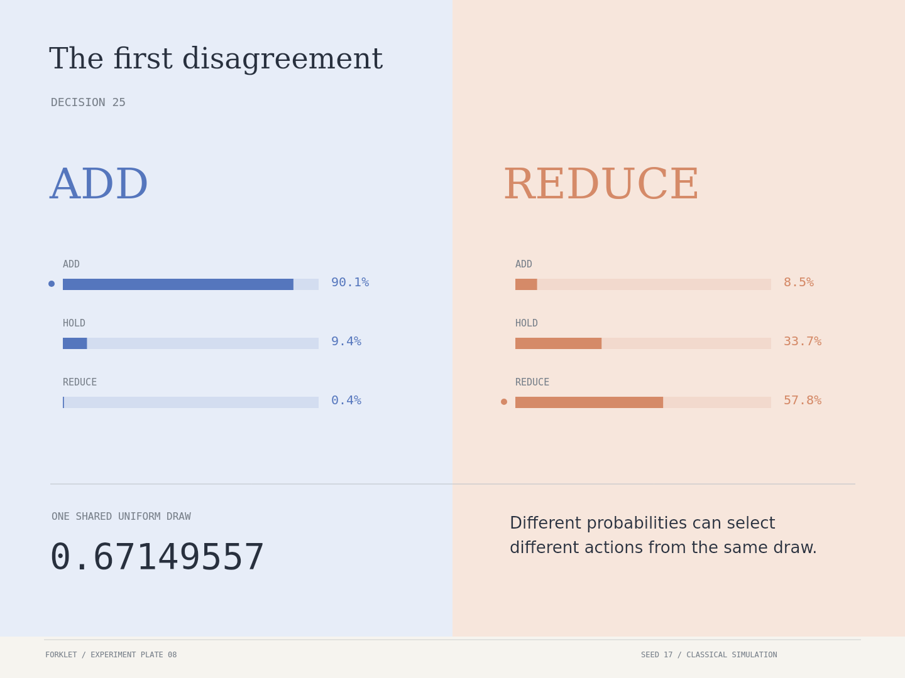
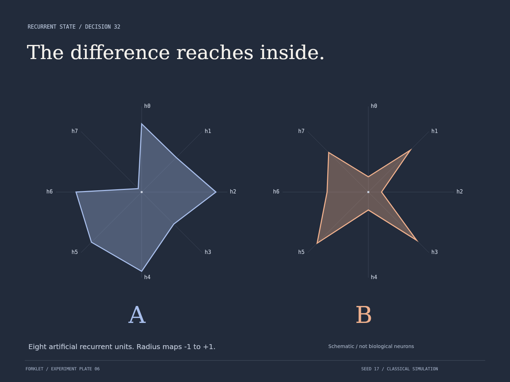
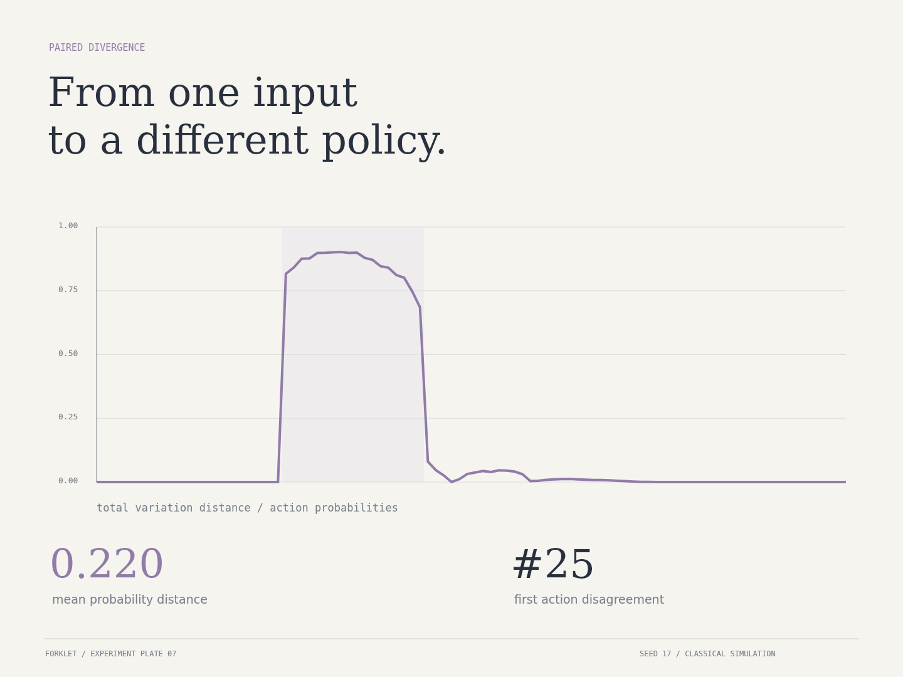
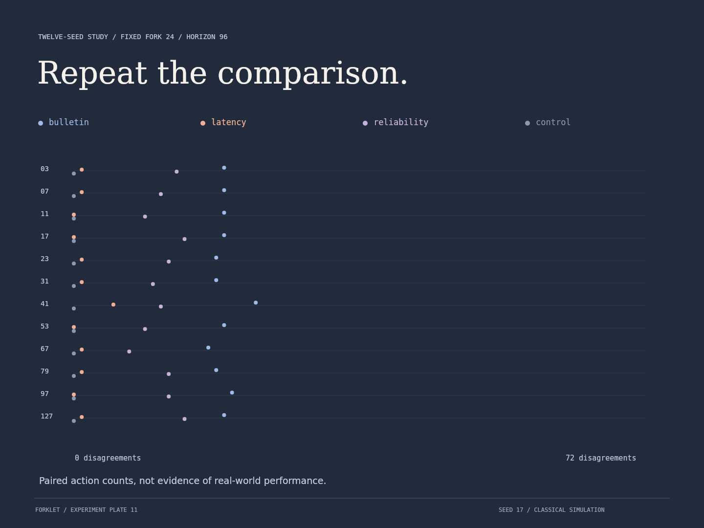
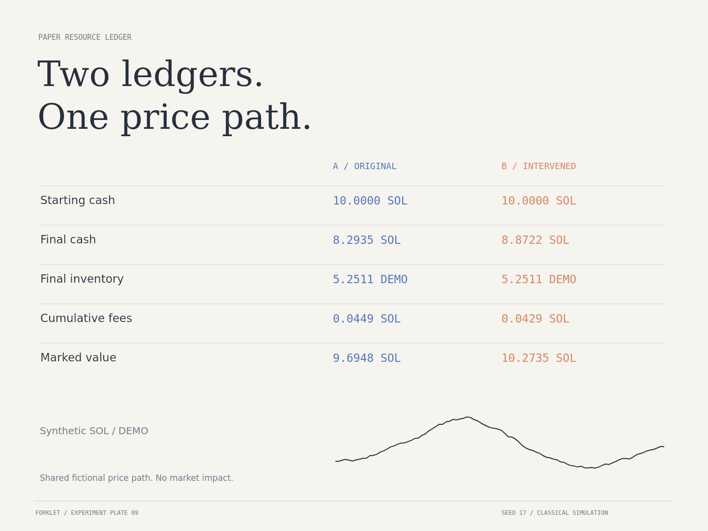
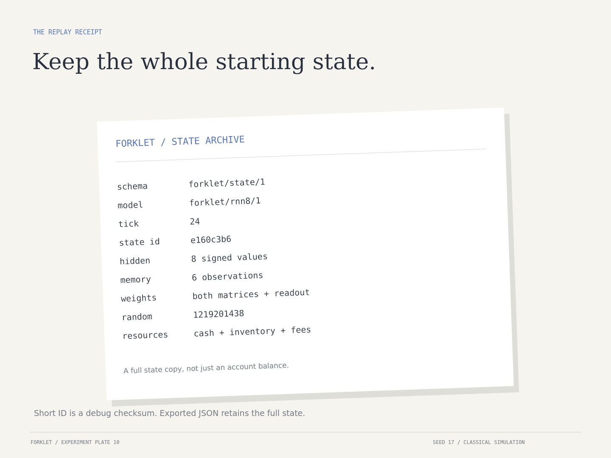

<p align="center">
  
</p>

# Forklet

Support Donations on Pumpfun: HsDmXKUpj8niAbFHoJet5AtwpBTTR7G43mjPkyFnpump

### One state. Two information paths.

Copy a decision system at an exact checkpoint. Change what one copy sees. Follow the difference through its memory, internal state, choices, and resources.


**Forklet is a local, reproducible decision-fork laboratory.** An eight-unit recurrent controller lives inside a small synthetic resource environment. At decision 24, its entire state is copied into A and B. A receives the original evidence. B receives one declared information intervention. Everything they do next is recorded.

The experiment is simple to see and detailed enough to inspect. A split is not a metaphor hidden behind a chat window: it is an actual deep copy of model parameters, activations, memory, balances, and the random-stream state.

| Edition | Controller | Study | Execution |
|---|---|---|---|
| 0.1.0 | Hand-specified recurrent model; 8 inputs, 8 units, 3 actions | 4 conditions × 12 seeds | Local; no account, API key, wallet, or runtime dependencies |

[Start](docs/QUICKSTART.md) · [Methods](docs/METHODS.md) · [Recorded results](experiments/RESULTS.md) · [Screenshot atlas](docs/SCREENSHOTS.md) · [GitHub upload](docs/GITHUB-UPLOAD.md)

## The question

**If two copies start with exactly the same state, when does different information make them behave differently?**

Forklet makes that question visible at several levels:

- **Evidence:** the raw observation and the effective observation are both retained.
- **State:** every step records eight recurrent activations and a six-observation memory window.
- **Policy:** both three-action probability distributions are retained, not just their winning actions.
- **Choice:** the copies consume the same seeded uniform draw at each paired step.
- **Resources:** a small SOL-denominated paper ledger shows downstream effects in a shared fictional market.

This is a classical software experiment, not a biological reconstruction, a language model, a claim of consciousness, or a quantum system. The controller has fixed, untrained weights. Its value is inspectability, not financial performance.

## Open the experiment

**Fastest:** download the repository ZIP, extract it, and open **`Forklet.html`**. It embeds the artwork, study data, styles, and code. No install is needed for this route.

**From source:** use Node.js 20 or newer.

```sh
git clone https://github.com/ashleyotooligan/forklet.git
cd forklet
npm start
```

Open `http://127.0.0.1:4173`. Do not open `index.html` directly: it loads local modules and study data through the server. The self-contained `Forklet.html` is the double-click version.

The interface lets you choose a study, set the seed and fork point, inspect a decision, switch among twelve plates, and export a PNG, checkpoint, or replay receipt. The twelve-seed plate is explicitly a fixed reference study; it does not silently change with the interactive seed.

## 01 / Preserve a complete beginning



The checkpoint is more than a balance or a transcript. It contains the complete model state needed by this engine:

| Field | What is preserved | Why it matters |
|---|---|---|
| Model | Two 8×8 matrices, bias vector, readout vector | Same decision computation |
| Hidden state | Eight signed recurrent activations | Same internal starting point |
| Memory | Up to six recent observations | Same short history |
| Resources | Cash, fictional inventory, cumulative fees | Same constraints |
| Previous action | Signed previous move | Same endogenous input |
| Random state | Serialized 32-bit stream state | Same future action draws |
| World configuration | Seed, horizon, fee and intervention settings | Reconstructs the shared synthetic environment |

The short state ID is an FNV-1a debug checksum. It is **not** collision-resistant proof, a signature, or an on-chain commitment. The exported checkpoint contains the full state, not merely this ID.



## 02 / Change one declared information path

| Condition | What B receives | What stays shared |
|---|---|---|
| Opposite bulletin | Bulletin sign inverted for 18 decisions | Price path, model, starting memory, action draws |
| Late evidence | Momentum and bulletin from six ticks earlier | Current execution price and other external channels |
| Lower reliability | Reliability channel set to 0.15 for 18 decisions | Price, bulletin, momentum and volatility |
| Identical evidence | No intervention | Everything; this is the negative control |

The intervention begins immediately after the saved checkpoint. Fork 24 means that 24 decisions are already complete; decision 25 is the first post-fork decision. In the default run, the intervention affects decisions 25–42 inclusive.



Only the declared exogenous channel is changed by the intervention. Once decisions differ, balances, exposure, and previous-action inputs may also differ naturally. Those are consequences of the split, not extra hidden interventions.

## 03 / Follow choices, not just a final score



Both copies consume exactly one uniform draw per step. This common-random-number coupling removes different action draws as an explanation for their disagreement in this paired experiment. It does not eliminate other modeling limitations.

A sampled **ADD** is an action request, not a guarantee of a nonzero purchase: cash and the exposure cap can block it. **REDUCE** can similarly produce zero execution if there is no inventory. The action film records selected decisions; the ledger records actual paper execution.



For the default seed, the first disagreement occurs at decision **25**. A selects ADD and B selects REDUCE using the same draw. Their distributions, not their random numbers, differ.

## 04 / Inspect the internal difference



These are eight artificial recurrent units, not measured neurons. The state sketches map activation −1 to the center and +1 to the perimeter. They are an inspectable projection of the actual recorded state.



Forklet records three complementary measurements:

1. **Action disagreement:** did the sampled actions differ at this step?
2. **Total variation:** how far apart were the two three-action probability distributions?
3. **Hidden-state L2:** how far apart were the eight-dimensional state vectors?

Different internal states do not always produce different sampled actions. In the default late-evidence run, probabilities and activations change, yet all 72 post-fork actions match. The internal difference later fades. See the full [metric definitions](docs/METRICS.md).

## Recorded study

Every number below is generated by the checked-in engine. Fork after decision 24; horizon 96; 18 intervention decisions; seed 17.

| Condition | First action disagreement | Differing actions / 72 | Mean probability TV |
|---|---:|---:|---:|
| Opposite bulletin | 25 | 19 | 0.220461 |
| Late evidence | none | 0 | 0.017162 |
| Lower reliability | 25 | 14 | 0.143772 |
| Identical evidence | none | 0 | 0.000000 |



The reference study includes **48 paired runs across 12 fixed seeds**, including all twelve negative controls. It is descriptive, not an optimized benchmark. Seeds are listed in [the generated results](experiments/RESULTS.md); complete summaries are in [data/batch.json](data/batch.json).

## A secondary resource experiment, denominated in SOL

Forklet uses a fictional DEMO asset priced in paper SOL to make decisions consequential without sending transactions. This is a downstream test environment, not the main identity of the project.



| Rule | Default |
|---|---|
| Initial cash | 10 paper SOL per agent before the shared history |
| ADD budget | At most 0.35 SOL per selected ADD |
| Exposure target | At most 60% marked asset exposure when adding |
| REDUCE size | At most 0.35 SOL of available fictional inventory |
| Execution fee | 0.3% of actual notional |
| Execution price | Current shared fictional price; no slippage or market impact |
| Marked value | Cash + DEMO units × current fictional price |

At the fork, both copies inherit the resources resulting from the shared first 24 decisions; they do not reset to 10 SOL. Fees are deducted during execution. Cumulative fees are displayed for audit and must not be subtracted a second time from marked value.

SOL here is a unit of account. There is no wallet connection, mainnet or devnet transaction, token mint, market feed, exchange route, or automatic trade. [Resource accounting](docs/RESOURCE-MODEL.md) explains the equations; [extension boundaries](docs/EXTENSIONS.md) describes how a future receipt anchor could be separated from the experiment itself.

## Replay the actual starting state



```sh
node scripts/replay.mjs examples/checkpoint.json
```

This restores the saved state, reconstructs the world from its seed, and continues original-evidence branch A. Its final state is compared against uninterrupted execution in the tests. A receipt documents the configuration and outputs; it is not an independent attestation.

```sh
npm test
npm run experiments
npm run build
npm run check
```

Runtime, tests, experiment generation and the standalone build use only Node's standard library. Regenerating the PNG figures additionally needs an optional native Canvas renderer and DejaVu fonts; instructions are in [reproducibility](docs/REPRODUCIBILITY.md).

For individual JSON configurations and follow-up studies, see [the experiment guide](docs/EXPERIMENTS.md).

## Twelve plates, not twelve copies of a dashboard

The visual system is an experiment folio: large typography, plain paper, blue/coral lineage marks, quiet annotations, and dark information studies. Each plate is composed for its subject rather than inserted into the same card layout.


All twelve figure images are rendered from the application drawing code and engine data. They are **application-generated experiment plates, not browser screenshots**. Character artwork is illustrative and generated separately; it is never presented as measured model output. See [art provenance](assets/PROVENANCE.md) and [the screenshot atlas](docs/SCREENSHOTS.md).

## Repository map

| Location | Contents |
|---|---|
| `src/core/` | Seeded stream, synthetic world, recurrent controller, state and execution |
| `src/lab/` | Paired fork runner, metrics, receipt |
| `src/view/` | Twelve plate compositions and accessible browser controls |
| `scripts/` | Local server, build, experiments, replay, capture and verification |
| `experiments/` | Four runnable JSON configurations and generated results |
| `data/` | Full default trace and fixed twelve-seed study |
| `examples/` | Exported configuration, checkpoint and receipt |
| `schemas/` | JSON format contracts |
| `assets/` | Original character artwork, cover and twelve PNG figures |
| `docs/` | Methods, model details, metrics, resources and upload instructions |
| `tests/` | Engine invariants, paired controls, state replay, datasets and UI wiring |

## Scope and research directions

The implemented release is deliberately small enough to audit. It has no trained intelligence, planning language model, live trading system, or blockchain backend. Its paired simulations do not establish investment value or general real-world causality. A deterministic seed is reproducibility machinery, not evidence of correctness by itself.

Useful next experiments include longer interventions, controlled memory ablations, externally supplied replay fixtures, independent replicate groups for uncertainty estimates, and a separate evidence-receipt pipeline. Each should preserve the negative control and state-export contract.

See [roadmap](docs/ROADMAP.md), [limitations](docs/LIMITATIONS.md), [architecture](docs/ARCHITECTURE.md), [contribution guide](CONTRIBUTING.md), and [security policy](SECURITY.md).

---

Created by **Ashley Tooligan**. Original Forklet character and project identity. [MIT license](LICENSE).
